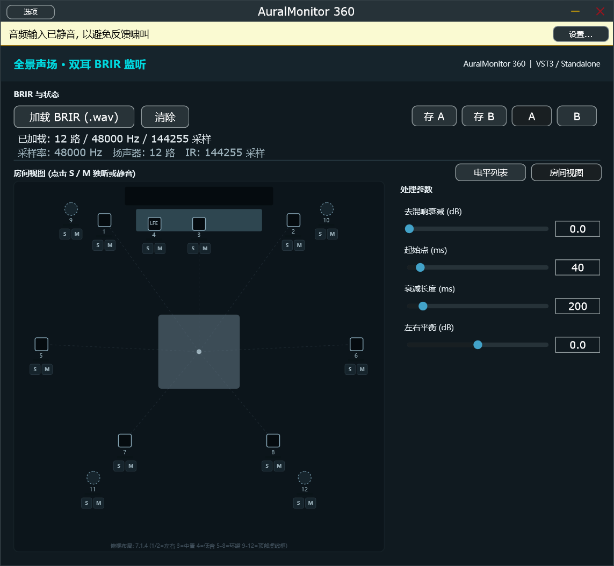
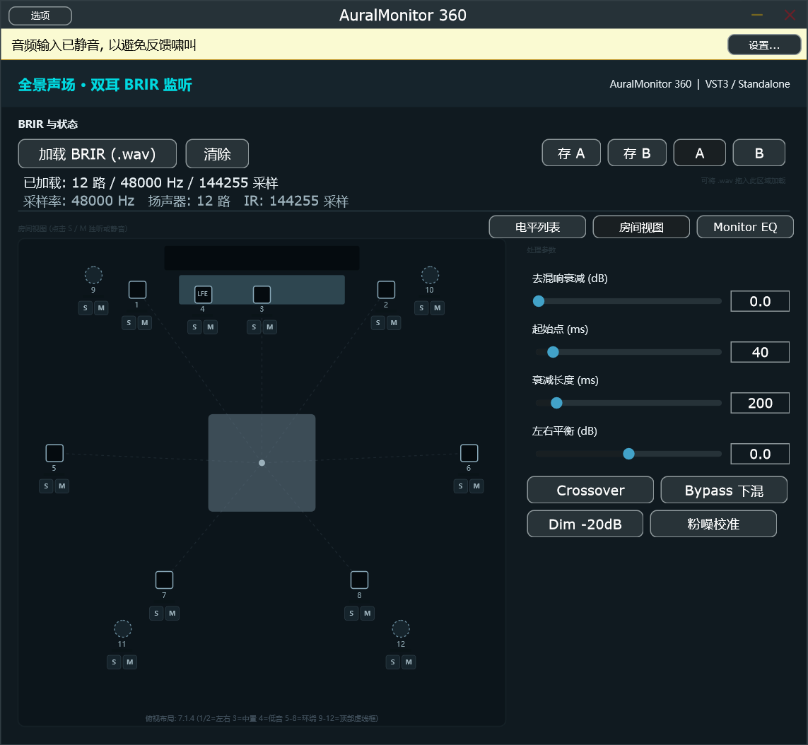

# AuralMonitor 360

**AuralMonitor 360** 是一款面向 Windows 平台的专业多声道（**5.1 / 7.1.4 / 9.1.6**）BRIR 双耳空间音频监听软件，提供 **Standalone 独立桌面版** 与 **VST3 插件** 两种形态，让你用普通监听耳机精准还原实体多声道混音室的声场与声像定位。

> 📥 **安装包下载**：请点击页面右侧 **[Releases](../../releases)** 下载最新 Windows 安装程序（`AuralMonitor360_v2.0_Setup.exe`）。  
> 📖 **离线文档**：[点击查看 / 下载 PDF 完整使用说明书](docs/AuralMonitor360_使用说明书.pdf)

---

## 界面预览

| 主监听界面（听音室视图） | 实时频谱与监听 EQ / 耳机补偿 |
| :---: | :---: |
|  |  |

---

## 核心特性

- **真多声道 BRIR 双耳卷积引擎**：支持 5.1 / 7.1.4（12 声道）/ 9.1.6（16 声道）声道顺序映射与逐路能量归一化。
- **开箱即用 + 拖拽换房间**：内置默认听音室 BRIR 脉冲；支持直接把自定义多声道 `.wav` BRIR 文件拖入界面实时切换。
- **录音棚级监听控制**：去混响（Dereverb）、多段监听 EQ 与实时频谱、常见监听耳机频响补偿预设、ITU-R BS.775 声压补偿 Bypass 下混、Dim 衰减、A/B 对比槽、单路 Mute/Solo、粉噪校准与迷你模式。
- **独立版智能音频桥接**：内置 WASAPI Loopback 跨设备直通桥接（无锁环形缓冲 + 自动重采样，解决输入输出采样率冲突）与专业实体 ASIO 直出。

---

## 快速上手

> **声明**：本软件安装包仅包含 **AuralMonitor 360** 本体，**不捆绑**任何第三方虚拟声卡或解码器安装包。

### 模式 A：DAW 插件模式（无需虚拟声卡）
在 Cubase / Nuendo / Reaper / Pro Tools / Studio One 等宿主中，直接将 **AuralMonitor 360 (VST3)** 加载到 7.1.4 或 9.1.6 监听总线轨即可使用。

### 模式 B：独立版监听系统声音（需自助安装虚拟声卡）
1. 前往官网自行下载安装虚拟声卡（二选一）：
   - **VB-Cable（免费轻量，适合日常）**：https://vb-audio.com/Cable/
   - **VB-Audio Matrix（推荐，支持 12 / 16 通道无损全景声）**：https://vb-audio.com/Matrix/
2. 打开 **AuralMonitor 360** 独立版，在弹窗中选择：
   - **输入源**：刚装好的虚拟声卡（如 `CABLE Input` 或 `VBMatrix In 1`）
   - **物理输出**：你的实体耳机或专业声卡（支持实体 ASIO 或 Windows Audio）
3. 将 Windows 系统播放设备切到对应的虚拟声卡，即可直接从耳机出声。

---

## 🎧 Windows 版 Apple Music 跑通杜比全景声教程（搭配 Final Spatial Audio / NSp）

Windows 版 Apple Music 只有在检测到系统默认音频端点支持 **空间音频（Dolby Atmos）** 时，才会真正输出多声道全景声。通过搭配第三方软件 **Final Spatial Audio（简称 NSp / NativeSpatialPipe）**，即可在 Windows 上完整跑通 **7.1.4 / 9.1.6 无损杜比全景声 → AuralMonitor 360 双耳渲染**。

### 完整信号链路
```text
Apple Music (Dolby Atmos)
   ↓
Final Spatial Audio (NSp 实时解码 7.1.4 / 9.1.6)
   ↓
虚拟声卡 (VB-Audio Matrix 12ch / 16ch)
   ↓
AuralMonitor 360 (BRIR 听音室双耳卷积 + 耳机补偿)
   ↓
实体耳机 / 专业声卡 (ASIO / Windows Audio)
```

### 详细步骤

1. **开启 Apple Music 杜比全景声**
   - 在 Microsoft Store 安装 Windows 版 **Apple Music**；
   - 进入 `设置 → 播放`，将 **杜比全景声（Dolby Atmos）** 设为 **始终打开（Always On）**。
2. **安装多通道虚拟声卡**
   - 前往官网自行下载并安装 **VB-Audio Matrix**（https://vb-audio.com/Matrix/），用于承接 12 声道（7.1.4）或 16 声道（9.1.6）无损音频流。
3. **安装并配置 Final Spatial Audio (NSp)**
   - 前往官方仓库自行下载并安装 **Final Spatial Audio (NSp / NativeSpatialPipe)**：https://github.com/BestGreed/NativeSpatialPipe
   - 在 NSp 配置向导中选择输出布局为 **7.1.4（12 声道）** 或 **9.1.6（16 声道）**；
   - 将 NSp 的多声道输出目标指向 **VB-Audio Matrix** 虚拟输入通道；
   - 在 Windows 声音设置中，将默认播放设备设为 NSp 接管的系统空间音频端点，并确认系统「空间音效」已开启。
4. **打开 AuralMonitor 360 接入渲染**
   - 启动 **AuralMonitor 360** 独立版；
   - 在「音频输入与耳机直通设置」弹窗中：
     - **输入源**选 `VBMatrix In 1`（跨设备桥接模式）或 `VB-Matrix VASIO-64A / VASIO-128`（ASIO 矩阵模式）；
     - **物理输出**选你的实体耳机或专业声卡（请勿选成虚拟声卡，避免回环）；
   - 在主界面确认声道格式与 NSp 一致（**7.1.4** 或 **9.1.6**）。
5. **验证效果**
   - 在 Apple Music 播放任意带有 **杜比全景声** 标识的歌曲；
   - 观察 AuralMonitor 360 的听音室视图：当 **12 路或 16 路扬声器电平表同步独立跳动** 时，即表示已成功跑通真多声道杜比全景声监听！

---

## 常见问题（FAQ）

- **打开独立版没有声音？**  
  确认 Windows 系统默认输出（或播放器输出）指向了虚拟声卡，且 AuralMonitor 360 的「物理输出」指向了你的实体耳机/声卡。
- **如何加载自己的 BRIR 听音室脉冲？**  
  直接把多声道 `.wav` BRIR 文件拖入 AuralMonitor 360 窗口松开即可实时切换。
- **问题反馈**  
  欢迎在本仓库的 **[Issues](../../issues)** 页面提交 Bug 反馈或功能建议。

---

## 声明
- 本仓库仅用于 **AuralMonitor 360** 的公开文档展示、版本发布与问题反馈，软件本体为闭源分发。
- 教程中提及的第三方工具（VB-Cable、VB-Audio Matrix、Final Spatial Audio / NSp、Apple Music 等）均由其各自官方独立提供，请从各自官方渠道下载。
